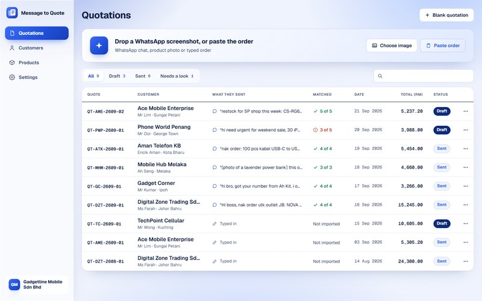
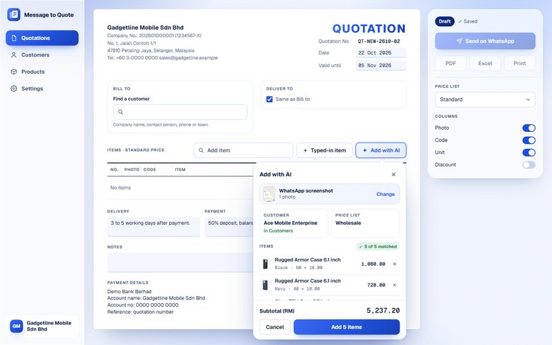
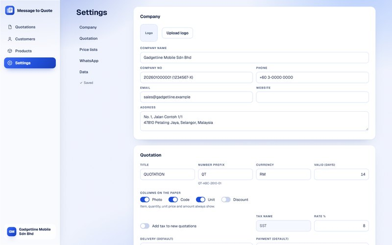
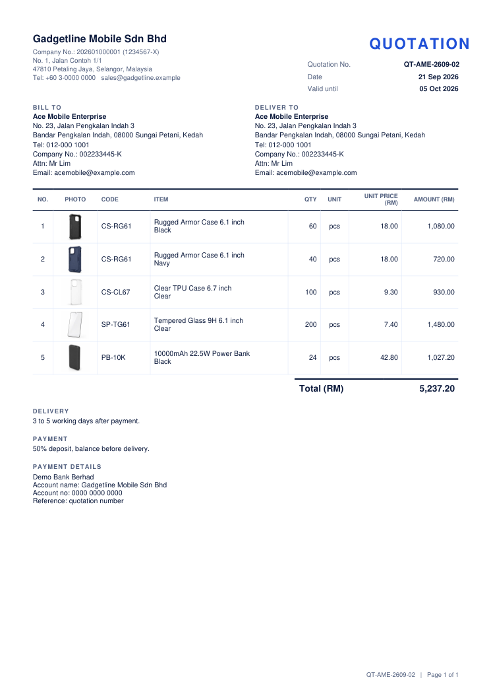

# Message to Quote

Paste a customer's order. The quotation builds itself.

A customer sends an order on WhatsApp: a list, a photo of a product, or a screenshot of the chat. Drop it into the app. The AI reads it, matches every line to your product list, picks the right price list, recognises the customer, and you get a quotation you can send as a PDF or straight to WhatsApp.

[中文说明](README.zh.md)



## Easiest setup: let your AI do it

Open [Claude Code](https://claude.com/claude-code) (or Codex, Cursor, any coding agent) in an empty folder and say:

> Set up this app for me: https://github.com/ameng-nocode/message-to-quote

The agent downloads the repo into that folder and follows [AGENTS.md](AGENTS.md): it runs every command itself and only stops for the few things a person must do, such as getting a free AI key. It never asks you to paste a key into the chat; it opens the `.env` file for you instead.

## What it does



- **Reads orders in any language**: typed or pasted text, product photos, chat screenshots (English, Malay, Chinese and more).
- **Matches your products**: by code, name, variant, or by comparing a customer's photo with your product photos. Anything you do not sell is listed apart, with the closest products you do sell. You see the whole list first and press **Add** when it is right.
- **Price lists**: one standard price per product, plus your own lists (Retail, Wholesale, Dealer...). "Give me dealer price" switches the whole quotation.
- **Knows your customers**: a saved customer is recognised from the chat name, phone number or company name; a new one is filled in from the message.
- **Your own quotation**: company details, logo, number prefix, currency, tax, which columns show, payment details and footer, all in Settings.
- **Out the door**: A4 PDF, Excel, print, or one click to open the customer's WhatsApp chat with the message typed in.
- **Products from Excel**: import your price list (one row per product), export it back, add photos.

|  |  |
|---|---|

## Two ways to run it

| | Browser mode | Supabase mode |
|---|---|---|
| Set up | Just an AI key | AI key + a free [Supabase](https://supabase.com) project |
| Login | None | Email and password, a team |
| Where the data lives | In that one browser | Your Supabase project, the same on every device |
| Good for | Trying it, a demo, one person on one computer | Real use, a sales team |

The app picks the mode by itself: no Supabase keys in `.env` means browser mode.

## Read this first

- **The AI sees the orders.** Every message, photo and screenshot you import is sent to the AI service whose key you use (Google Gemini, OpenAI or OpenRouter), along with your product names and small product pictures. Check their terms if your orders are sensitive.
- **The AI key is yours and sits on your server.** In Supabase mode only signed-in team members can use it (`ASSIST_LIMIT_PER_HOUR` calls per person per hour, 40 by default). Browser mode has no login, so there Add with AI only works on your own computer or local network; online it stays off.
- **Check the AI's work.** It is good, not perfect. Every import shows what matched, what changed and what is not in your product list.
- Not affiliated with WhatsApp, Meta, Google, OpenAI or Supabase. Names are trademarks of their owners.

## Set it up by hand

You need [Node.js](https://nodejs.org) 22 or newer (20.12 also works) and [Git](https://git-scm.com).

```bash
git clone https://github.com/ameng-nocode/message-to-quote.git
cd message-to-quote
npm install
npm run setup
```

`npm run setup` makes your `.env` file and tells you what is missing. Put one AI key in `.env`. The free one is Gemini: get a key at https://aistudio.google.com/apikey and paste it after `GEMINI_API_KEY=`.

```bash
npm run dev
```

Open http://localhost:3000. That is browser mode, ready to use. Click **Load sample data** to try it with an invented phone shop wholesaler, and drop one of the screenshots from [demo-data/whatsapp](demo-data/whatsapp) onto the import box.

### Add Supabase (login and a team)

```bash
npm run setup:supabase -- --owner-email you@example.com
```

Use the email you will sign in with: only that email can create the owner account.

The first time, it asks for a Supabase access token: make a free account at https://supabase.com/dashboard, create a token at https://supabase.com/dashboard/account/tokens, and paste it into `.env` after `SUPABASE_ACCESS_TOKEN=`. Run the command again. It then:

1. makes a Supabase project (Singapore by default, `-- --region <name>` for another),
2. creates the tables, the security rules (every table is locked to your team) and private storage for pictures,
3. sets login to email + password with no confirmation email,
4. locks the owner account to your email, so nobody else can claim the project,
5. writes the project address and public key into `.env`, and empties the access token line again.

Restart `npm run dev`. `npm run setup:check` shows where things stand at any time.

<details>
<summary>Without the setup script</summary>

1. Make a project at https://supabase.com/dashboard.
2. `npx supabase link --project-ref <your ref>` then `npx supabase db push` (this runs [supabase/migrations](supabase/migrations)).
3. Dashboard, Authentication, Sign In / Providers, Email: turn off **Confirm email**.
4. Dashboard, Project Settings, API Keys: copy the project URL and the `anon` public key into `.env` as `NEXT_PUBLIC_SUPABASE_URL` and `NEXT_PUBLIC_SUPABASE_ANON_KEY`.

</details>

## Login (Supabase mode)

- **The owner account is yours.** Open the app after setup and create it with the owner email you gave the setup. Any other email is refused, so nobody can claim the project before you.
- **After that, sign up is closed.** Only emails the owner invited can make an account. This is enforced inside the database, not just hidden in the app.
- **Invite someone:** Settings, Team, add their email. Send them the app link (there is a Copy app link button). They choose **Invited? Create your account** and use that same email.
- **Remove someone:** Settings, Team, the x next to their name. They can still sign in but see nothing. To delete their login entirely: Supabase dashboard, Authentication, Users.
- **Forgot password:** the login page sends a reset link by email. Supabase's built-in email only sends a few per hour; for more, add your own SMTP in the Supabase dashboard (Authentication, Emails).
- **Online:** set the live address as Site URL in the Supabase dashboard (Authentication, URL Configuration), so reset links open your app.

## Your company and quotation format

Everything is in **Settings**:

- Company: name, company number, address, phone, email, website, logo.
- Quotation: title on the paper, number prefix (`QT` gives `QT-ABC-2610-01`), currency, how many days it is valid, which columns show (photo, code, unit, discount), tax (name and rate, for example SST 8%), default delivery and payment terms, notes, payment details (bank account), footer.
- Price lists: add, rename, delete.
- WhatsApp: your country code (for numbers that start with 0) and the message that goes with the PDF.

## Products and prices

On the **Products** page: add, edit, duplicate and delete products, with a photo. Photos are optional, but they let the AI match a customer's product photo.

To load a whole price list, click **Import** and choose an Excel (.xlsx) or CSV file, one product per row:

| code | name | variant | category | unit | price | Wholesale | Dealer | description | photo |
|---|---|---|---|---|---|---|---|---|---|
| CS-RG61 | Rugged Armor Case 6.1 inch | Black | Phone Case | pcs | 29 | 18 | 15.7 | Military drop protection | |

- Only `name` and `price` are needed. `price` is the standard price.
- Every other column with prices becomes a price list with that name (created if it is new). The currency and the word "price" in a column name are ignored: `Wholesale Price (RM)` fills the Wholesale list.
- A product already in the list (same code and variant, or same name when there is no code) is updated, not added twice.
- `photo` can be an image link (https). Otherwise add photos in the app.
- The **Template** button downloads an empty sheet with the right columns. [demo-data/products-sample.csv](demo-data/products-sample.csv) is a full example.

### How the numbers are worked out

- Amount = quantity x unit price, less the line's discount %, rounded to the cent (half up: 0.945 becomes 0.95).
- Subtotal = the amounts added up. Tax = the tax % of the subtotal, rounded to the cent. Total = subtotal + tax.
- Prices are kept to 2 decimals, quantities and discounts to 3 (2.5 kg, 1.5 hours, 12.5%).
- A new line takes its price from the quotation's price list. A product with no price in that list goes in at 0, for you to type the price.
- The screen, the printed page, the PDF and the Excel file all use the same numbers.

## AI keys and cost

One key is enough. With more than one, the next one takes over when the first runs out of credit or is busy.

| Key in `.env` | Model (default) | Cost |
|---|---|---|
| `GEMINI_API_KEY` | gemini-2.5-flash | Free tier for small use, https://aistudio.google.com/apikey |
| `OPENAI_API_KEY` | gpt-4.1-mini | Paid, less than 1 US cent per order |
| `OPENROUTER_API_KEY` | google/gemini-2.5-flash | Paid, one key for many models |

Change the order with `ASSIST_PROVIDERS=gemini,openai,openrouter` and the models with `ASSIST_MODEL_GEMINI` and friends.

## Put it online

Online means Supabase mode. First run `npm run setup:check`: it must say `owner email lock: on` and `owner account: yes`.

Vercel is the simplest: import the repo, add the AI key and the two `NEXT_PUBLIC_SUPABASE_` keys from your `.env` under Environment Variables, deploy. Do not add the database password or the access token: the app does not need them. Any host that runs Next.js works (Railway, Render, your own server with `npm run build && npm start`).

Then set the live address as Site URL in the Supabase dashboard (Authentication, URL Configuration).

Browser mode online has no login, so Add with AI stays off there (anyone with the link would spend your AI credit). `ALLOW_PUBLIC_AI=1` in the host's settings turns it on anyway, at your own risk.

Picture links (product photos, logo) work for 7 days, then the app makes new ones. Anyone you give such a link to can open that one picture until then.

## Limits

- The PDF uses a built-in font that cannot draw Chinese or other non-Latin characters. Use **Print** (and Save as PDF in the print window) for those quotations.
- The AI gets your whole product list with each order. That works well up to about 2,000 products.
- Browser mode keeps everything in the browser's storage, about 5 MB. Product photos fill it first. Supabase mode has no such limit.
- One company per Supabase project.

## Project layout

```
src/app/           pages: quotations, editor, print, customers, products, settings, login, /api/assist (the AI)
src/lib/           data: settings, products, customers, quotations, PDF and Excel, sample data, Supabase
supabase/          migrations (tables, security rules, storage) and config.toml (login settings)
scripts/setup.mjs  npm run setup / setup:supabase / setup:check
tests/             npm test: the money, price list, numbering and import rules (run it after changing src/lib)
demo-data/         sample WhatsApp order screenshots and a sample product sheet
```

## License

MIT. See [LICENSE](LICENSE).
